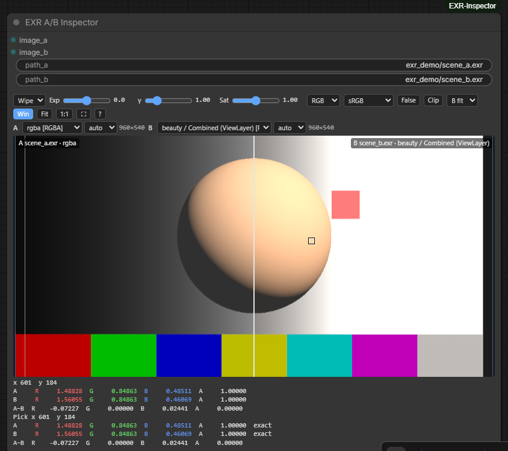
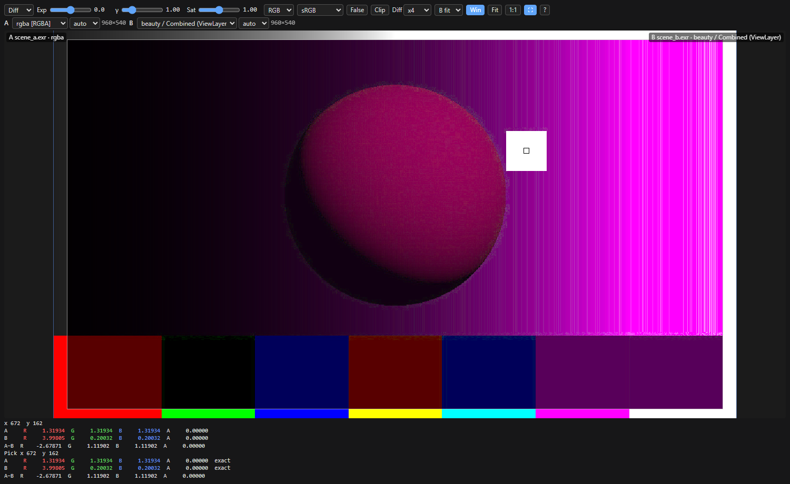
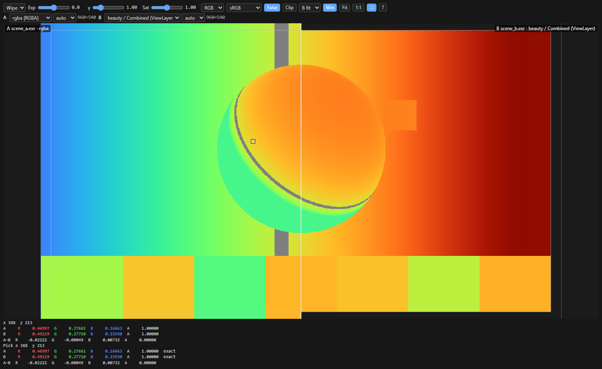
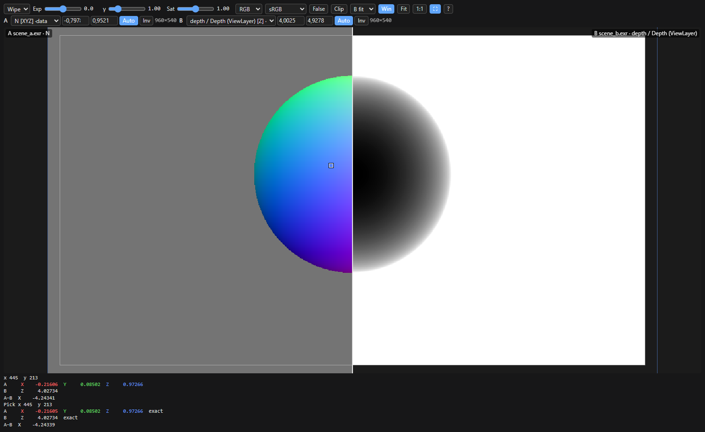

# ComfyUI-EXR-Inspector

**EXR inspection and A/B QC for renders and AOVs, inside ComfyUI.** Made by a VFX
compositor to check heavy multilayer EXRs the way you would in a compositing viewer:
wipe a render against another (or against what your workflow generated), read the
exact float under the cursor, look at depth, normals and vectors as data.

What it is good at: big multilayer files (decoded on the server, one layer at a time,
any compression), overscan, data passes and exact values. What it is not: a general
viewer panel. If you want Nuke-style buffers, video playback and a gallery, look at
[ComfyUI-NukeViewer](https://github.com/maxsarlijagit/ComfyUI-NukeViewer) or the viewer
in [Radiance](https://github.com/fxtd-studios/radiance).

> **Status: early release (v0.1).** Bugs and requests:
> [issues](https://github.com/dborrull/ComfyUI-EXR-Inspector/issues).



| Difference ×4, exact values on Ctrl+click | False colour (stops from 18% grey) | Data layers: normals vs depth |
|---|---|---|
|  |  |  |

## The node

**EXR A/B Inspector** (`image/EXR Inspector`). Each side takes an `IMAGE` from the graph
or a path. A path wins over the image and shows up at once, without running the workflow.

- Wipe, blink and difference (with gain) between A and B; zoom and pan are shared.
- Exposure in stops, gamma and saturation, shared by A and B; R / G / B / A / luminance.
- Eyedropper: raw values of A, B and A−B at the same pixel. Ctrl+click reads the exact
  float from the file, even when the browser holds a float16 proxy.
- False colour (stops from 18% grey; heat map on data layers) and clipping zebras
  (> 1 red, < 0 blue, NaN/inf magenta).
- Per side: layer, input space (auto / sRGB / linear). View transform sRGB, gamma 2.2,
  gamma 2.4 or raw.
- Data layers (depth, normals, position, vectors...) skip the view transform and use a
  min/max remap (auto ignores the depth background) with invert; exposure and gamma
  apply after the remap, as in Nuke's viewer.
- B either fits A's format or lines up pixel for pixel. Display window (grey) and data
  window (blue) outlines.
- Fullscreen button. All settings are saved with the workflow.

| keys (pointer over the viewer) | |
|---|---|
| wheel / drag | zoom / move the wipe (pan in other modes) |
| middle, Alt or Space + drag | pan |
| double-click, F / 0 | fit / 100% |
| Ctrl+click | exact values from the file |
| 1 2 W K D | A, B, wipe, blink, diff |
| R G B A Y | channel (again: RGB) |
| [ ] / E | exposure −/+ 0.5 / reset exposure, gamma and saturation |
| X / Z | false colour / clipping |

`python tests/make_demo.py` writes two demo EXRs to `tests/_data/demo` to try it out.

## EXR support

Files (EXR, and also HDR, TIFF, PNG, JPG, DPX...) are decoded on the server with OpenImageIO and sent to the browser as float16,
one layer at a time:

- every OpenEXR compression (NONE, RLE, ZIPS, ZIP, PIZ, PXR24, B44, B44A, DWAA, DWAB),
  scanline and tiled, multipart;
- Nuke and Blender layer names (`depth.Z`, `ViewLayer.Combined.R`...);
- data and display windows (overscan) and chromaticities (converted to Rec.709 for display);
- huge images are read in strips and box-filtered to a proxy (4096 px by default); the
  eyedropper still reads the exact float value from the file.

Deep EXR, full OCIO, sequences and Cryptomatte decoding are out of scope for v1.

## Install

From ComfyUI-Manager: search for **EXR Inspector**. Or with comfy-cli:

```
comfy node install comfyui-exr-inspector
```

By hand: clone into `ComfyUI/custom_nodes` and install the requirements with ComfyUI's
Python (`python_embeded\python.exe` on the Windows portable build):

```
python -m pip install -r requirements.txt
```

## Paths and settings

By default the node only reads files inside ComfyUI's `input`, `output` and `temp` folders.
Relative paths are looked up in `input`, then `output`.

To change that, copy `config.example.json` to `config.json`:

| key | default | |
|---|---|---|
| `allow_any_path` | `false` | read any path on the machine |
| `extra_roots` | `[]` | extra folders that are allowed |
| `cache_mb` | `2048` | RAM for decoded layers |
| `max_texture` | `4096` | longest side sent to the browser |

`EXR_INSPECTOR_ALLOW_ANY_PATH=1` also turns free paths on. This is a server setting on
purpose: a workflow you download cannot switch it on.

## Tests

```
python -m unittest discover -s tests -v
```

## License

MIT, © 2026 David Borrull.
